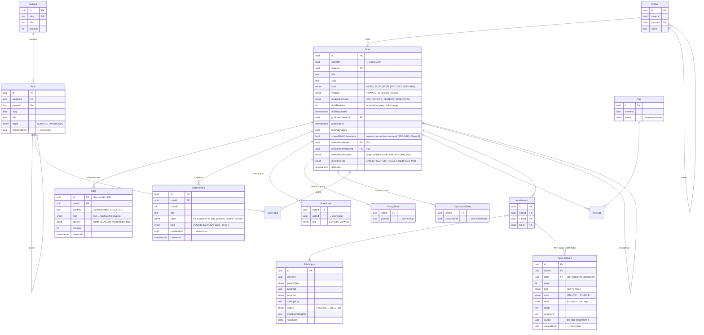
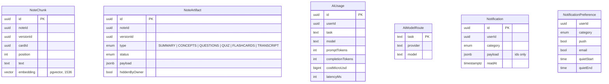

# Entity-relationship diagram

Derived from [section 4](lvn-architecture-v2.md#4-domain-model) and the context ownership in
[section 6.1](lvn-architecture-v2.md#61-bounded-contexts). Owned by lvn-backend; this is the Phase 0 draft for sign-off.

Rules the diagram obeys: every id is UUIDv7; relationships **inside** a context are foreign keys; references
**across** contexts (dashed in the notes below) are plain UUID columns with a local read model, never a foreign key.

## users (schema `users`)

```mermaid
erDiagram
  User ||--o{ Session : has
  User ||--o{ OAuthAccount : links
  User ||--o{ DeviceToken : registers
  User ||--o{ Membership : "belongs to"
  Organization ||--o{ Membership : has
  User ||--o{ ConsentRecord : accepts
  User ||--o| InstitutionalEmail : "verifies (ADR-0017)"
  User ||--o{ VerificationRequest : "asks (ADR-0019)"
  User ||--o| StudentProfile : "ADR-0026"
  User ||--o| UserPlan : "ADR-0024"
  Plan ||--o{ Entitlement : "ADR-0024"
  User ||--o| LegacyImport : "ADR-0023"
  User ||--o{ Follow : "follows (teacher, or student → student)"
  User ||--o{ Block : blocks
  User ||--o{ Restriction : restricts
  User ||--o{ Connection : "connected (teachers)"
  User ||--o{ ConnectionRequest : sends
  User ||--o{ AuditLog : "acts in"

  User {
    uuid id PK
    citext email UK
    text handle UK
    text passwordHash "Argon2id, nullable for OAuth-only"
    timestamptz emailVerifiedAt
    date dateOfBirth "required (ADR-0017)"
    timestamptz institutionVerifiedAt
    enum globalRole "STUDENT | TEACHER | PLATFORM_ADMIN"
    timestamptz deletionRequestedAt
    timestamptz deletedAt
  }
  Session {
    uuid id PK
    uuid userId FK
    uuid familyId "reuse of a rotated token revokes the family"
    bytea refreshTokenHash "SHA-256"
    jsonb device
    timestamptz expiresAt
    timestamptz revokedAt
  }
  OAuthAccount {
    uuid id PK
    uuid userId FK
    enum provider "GOOGLE | GITHUB | LINKEDIN"
    text providerSubject "GOOGLE: Firebase UID (ADR-0007, ADR-0100)"
    bytea encryptedRefreshToken
  }
  DeviceToken {
    uuid id PK
    uuid userId FK
    text fcmToken UK
    enum platform
    timestamptz lastSeenAt
  }
  Organization {
    uuid id PK "read model from the admin app"
    text name
    text_array emailDomains "ADR-0017"
  }
  StudentProfile {
    uuid userId FK
    text department
    enum yearOfStudy
    uuid_array interestTopicIds
    bool showOnProfile
  }
  Plan {
    uuid id PK
    text code "FREE today"
  }
  Entitlement {
    uuid planId FK
    enum key "LimitKey"
    bigint limit "null = unlimited"
    enum appliesToRole "optional: STUDENT | TEACHER"
  }
  UserPlan {
    uuid userId FK
    uuid planId FK
  }
  LegacyImport {
    uuid userId FK
    text legacyUid "Firebase UID"
    enum status "NOT_FOUND | AVAILABLE | CLAIMED | DECLINED"
    timestamptz claimedAt
  }
  VerificationRequest {
    uuid id PK
    uuid userId FK
    enum method "TEACHER | DOCUMENTS"
    uuid teacherId "TEACHER method"
    enum status "PENDING | APPROVED | REJECTED | WITHDRAWN"
    text message
    bool collegeIdCard "ADR-0099: one college ID card, deleted at the decision"
    uuid decidedBy
    timestamptz decidedAt
    text reason
  }
  AppSetting {
    text key PK "student_id_verification (ADR-0099, missing means off); google_sign_in (ADR-0100, inserted on)"
    bool enabled
    uuid updatedBy
    timestamptz updatedAt
  }
  InstitutionalEmail {
    uuid userId FK
    citext email UK
    text domain
    uuid organizationId FK
    bytea codeHash
    timestamptz codeExpiresAt
    int attempts
    timestamptz verifiedAt
  }
  Membership {
    uuid userId FK
    uuid organizationId FK
    enum role "ORG_ADMIN | TEACHER | STUDENT"
  }
  Follow {
    uuid followerId FK "any user"
    uuid followeeId FK "a teacher, or a student followed by a student"
    timestamptz createdAt
  }
  Connection {
    uuid userLowId FK "ordered pair, one row per connection"
    uuid userHighId FK
    timestamptz createdAt
  }
  ConnectionRequest {
    uuid id PK
    uuid fromUserId FK
    uuid toUserId FK
    enum status "PENDING | ACCEPTED | DECLINED | WITHDRAWN"
    timestamptz createdAt
    timestamptz respondedAt
  }
  Block {
    uuid blockerId FK
    uuid blockedId FK
    timestamptz createdAt
  }
  Restriction {
    uuid restricterId FK
    uuid restrictedId FK
    timestamptz createdAt
  }
  ConsentRecord {
    uuid id PK
    uuid userId FK
    enum document "TERMS | PRIVACY | PUBLIC_LICENCE"
    text version
    timestamptz acceptedAt
  }
  AuditLog {
    uuid id PK
    uuid actorId
    text action
    text entityType
    uuid entityId
    jsonb diff "never note content"
    timestamptz at
  }
```

Also in `users`: `OrganizationPlan(organizationId, planId, seats)` (ADR-0024). In `notes`:
`PdfConversion(id, userId, fileId, noteId, status, pages, pagesNeedingReview[])` (ADR-0025). In `ai`:
`AiTaskRun(id, userId, task, sourceNoteId | sourceFileId, status, resultNoteId, artifactId)` (ADR-0025). In `core`:
`LegacyEvent` archive (24 months, ADR-0023).

Later (ADR-0012, Phase 3 manual / Phase 7 import), also in `users`: `TeacherProfile(userId, headline, bio, topicIds[])`,
`TeacherSkill(id, userId, kind, name, detail, source, sourceUrl, fetchedAt, status)` and
`ExternalIdentity(id, userId, kind, value, verifiedAt)`.

## notes (schema `notes`)

Read models kept by `notes`: `membership_read_model(userId, groupId | classroomId)` and
`connection_read_model(userId, connectedUserId)` (ADR-0013) for `visibleNotesWhere`.

## core (schema `core`)

```mermaid
erDiagram
  Group ||--o{ GroupMember : ""
  Group ||--o{ GroupJoinRequest : "awaiting Admin/Owner"
  Group ||--o{ GroupPost : ""
  Group ||--o| GroupRepository : "PROJECT type"
  Group ||--o{ Doubt : "PROJECT type"
  Doubt ||--o{ DoubtAnswer : ""
  Group ||--o{ MentorInvite : ""
  Classroom ||--o{ ClassroomMember : ""
  Classroom ||--o{ ClassroomJoinRequest : "awaiting Teacher/TA"
  Classroom ||--o{ ClassroomInvite : "pre-approved"
  Quiz ||--o{ Question : ""
  Question ||--o{ Choice : ""
  Quiz ||--o{ QuizAttempt : ""
  QuizAttempt ||--o{ Answer : ""
  FlashcardDeck ||--o{ Flashcard : ""
  Flashcard ||--o{ FlashcardReview : "FSRS state per user"
  Resource ||--o{ ResourceSave : ""
  Resource ||--o{ ResourceRecommendation : ""
  Achievement ||--o{ UserAchievement : ""
  Report ||--o{ ModerationAction : ""

  Group {
    uuid id PK
    text name
    enum type "COMMUNITY | PROJECT (ADR-0015)"
    enum privacy "PUBLIC | PRIVATE"
    enum joinPolicy "OPEN | APPROVAL (ADR-0011)"
    timestamptz deletedAt
  }
  GroupMember {
    uuid groupId FK
    uuid userId
    enum role "OWNER | ADMIN | MODERATOR | MEMBER | MENTOR"
    timestamptz mutedUntil
  }
  GroupJoinRequest {
    uuid id PK
    uuid groupId FK
    uuid userId
    enum status "PENDING | APPROVED | REJECTED | WITHDRAWN"
    text message
    uuid reviewedBy
    timestamptz reviewedAt
    timestamptz createdAt
  }
  GroupRepository {
    uuid groupId FK
    enum provider "GITHUB | GITLAB"
    text url
    bool isPrivate
    jsonb metadata "public API snapshot"
    timestamptz refreshedAt
  }
  Doubt {
    uuid id PK
    uuid groupId FK
    uuid askedBy
    text title
    jsonb body "cards"
    text repoRef "file:line or commit, optional"
    enum status "OPEN | ANSWERED | RESOLVED"
    uuid resolvedBy
  }
  DoubtAnswer {
    uuid id PK
    uuid doubtId FK
    uuid answeredBy
    bool byMentor
    jsonb body
  }
  MentorInvite {
    uuid id PK
    uuid groupId FK
    uuid teacherId
    uuid invitedBy
    timestamptz expiresAt
    timestamptz acceptedAt
  }
  Classroom {
    uuid id PK
    uuid organizationId
    text name
    text joinCode UK
    timestamptz deletedAt
  }
  ClassroomMember {
    uuid classroomId FK
    uuid userId
    enum role "TEACHER | TA | STUDENT"
  }
  ClassroomJoinRequest {
    uuid id PK
    uuid classroomId FK
    uuid userId
    enum via "CODE | LINK"
    enum status "PENDING | APPROVED | REJECTED | WITHDRAWN"
    uuid reviewedBy
    timestamptz reviewedAt
    timestamptz createdAt
  }
  ClassroomInvite {
    uuid id PK
    uuid classroomId FK
    uuid invitedUserId
    uuid invitedBy "Teacher or TA"
    timestamptz expiresAt
    timestamptz acceptedAt
  }
  Quiz {
    uuid id PK
    uuid ownerId
    uuid classroomId
    uuid sourceNoteVersionId
    timestamptz publishedAt
    timestamptz deletedAt
  }
  QuizAttempt {
    uuid id PK
    uuid quizId FK
    uuid userId
    uuid clientOpId UK
  }
  FlashcardReview {
    uuid flashcardId FK
    uuid userId
    jsonb fsrsState
    timestamptz dueAt
    uuid clientOpId UK
  }
  Exam {
    uuid id PK
    uuid userId
    text name
    date examDate
    uuid_array topicIds
  }
  LearningEvent {
    uuid id PK
    uuid userId
    enum type
    text entityType
    uuid entityId
    int durationMs
    timestamptz serverTs "partition key, monthly"
  }
  Recommendation {
    uuid userId
    enum kind
    uuid entityId
    float score
    text reason
    timestamptz expiresAt
  }
  Resource {
    uuid id PK
    enum type
    text url
    uuid submittedById
    enum status "PENDING | APPROVED | REJECTED"
  }
  Comment {
    uuid id PK
    enum targetType "NOTE | CARD | RESOURCE | GROUP_POST"
    uuid targetId
    uuid authorId
    timestamptz deletedAt
  }
  Report {
    uuid id PK
    text entityType
    uuid entityId
    uuid reporterId
    enum reason
    enum status
  }
  ModerationAction {
    uuid id PK
    uuid reportId FK
    uuid actorId
    enum action "hide | remove | warn | suspend | dismiss"
  }
```

Also in `core`: `RhythmWeek(userId, weekStart, targetDays, countedDays, comebacks, paused)`, `RhythmPause`, `ExamReadiness` (ADR-0030, replacing `Streak`), `PointsLedger`, `Reaction`, `JobStatus` (per context that runs jobs).

## ai (schema `ai`) and communication (schema `comms`)

Shared infrastructure tables, one per schema that needs them: `outbox` (transactional outbox, §9.1) and
`feature_flag` (in `users`, read via GraphQL).
